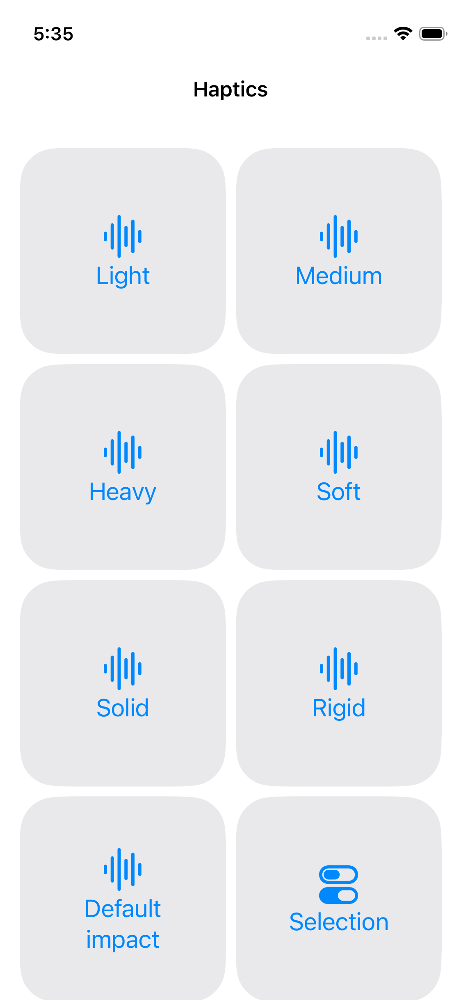
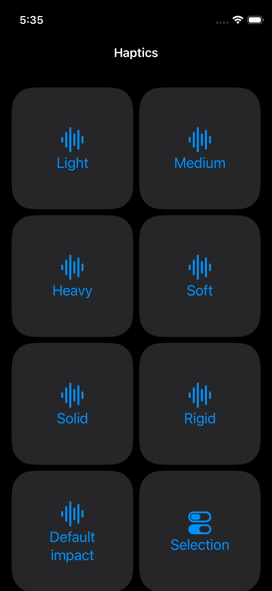
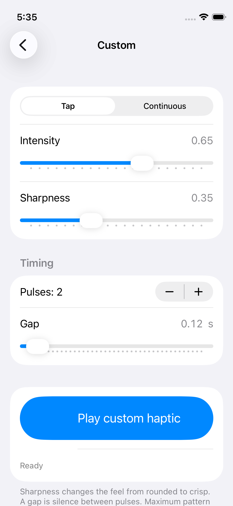

# HapticsLab

A native SwiftUI playground for exploring system feedback, configurable Core Haptics patterns, and Apple Pencil Pro canvas feedback. This README is the starting point for iOS developers and coding agents: it covers setup, API mappings, implementation, extension points, and verification.

The app targets **iOS/iPadOS 26.0**, uses **Swift 6**, and supports iPhone and iPad. It has no third-party dependencies, accounts, analytics, permission prompts, or app-owned network services. Custom patterns are generated in code; no AHAP files or audio assets are required.

## Contents

- [Build and run](#build-and-run)
- [Native feedback catalog](#native-feedback-catalog)
- [Custom patterns](#custom-patterns)
- [Source map](#source-map)
- [State, concurrency, and playback lifecycle](#state-concurrency-and-playback-lifecycle)
- [Changing or reusing the implementation](#changing-or-reusing-the-implementation)
- [Tests and verification](#tests-and-verification)
- [Troubleshooting](#troubleshooting)
- [Workflow for coding agents](#workflow-for-coding-agents)
- [Apple references](#apple-references)

## Build and run

1. Clone the repository and open [HapticsLab.xcodeproj](HapticsLab.xcodeproj) in Xcode.
2. Use an Xcode toolchain that supports the project's Swift 6 syntax, including `nonisolated` types and default actor isolation, and an iOS SDK supporting the deployment target. The deployment target is a runtime requirement, not a claim that every older Xcode release builds this source.
3. Select the **HapticsLab** scheme and an installed iOS simulator. Choose **Product → Run** to explore the interface, or **Product → Test** to run the tests.
4. To feel feedback, run on a supported physical iPhone. Configure your own development team under **Signing & Capabilities**; adjust the bundle identifier locally if provisioning requires it. Keep personal signing changes out of commits.
5. For canvas feedback, use Apple Pencil Pro with a compatible iPad. These buttons do not represent iPhone Taptic Engine patterns.

No package installation, API keys, backend, or additional data setup is needed. The UI uses in-memory state; custom parameter edits are not saved as presets across launches.

The simulator can verify requests, pattern construction, and controls, but cannot reproduce physical vibration. A status of **Requested** confirms a request was dispatched, not that hardware produced feedback. Actual feedback depends on hardware, system settings, and app state.

### Screenshots

Existing captures from the iPhone 13 mini simulator on iOS 26.5:

<p>
  
  
  
</p>

## Native feedback catalog

The home screen uses two columns of rounded square buttons with a compact navigation title. System patterns retain their default parameters so they provide a consistent baseline for comparison.

| Button | API used by this app |
| --- | --- |
| Light, Medium, Heavy | `SensoryFeedback.impact(weight: .light / .medium / .heavy)` |
| Soft, Solid, Rigid | `SensoryFeedback.impact(flexibility: .soft / .solid / .rigid)` |
| Default impact | `SensoryFeedback.impact` |
| Selection | `SensoryFeedback.selection` |
| Success, Warning, Error | `SensoryFeedback.success / .warning / .error` |
| Alignment | `SensoryFeedback.alignment` |
| Canvas alignment | `UICanvasFeedbackGenerator.alignmentOccurred(at:)` |
| Canvas path completed | `UICanvasFeedbackGenerator.pathCompleted(at:)` |

[NativeHaptic.swift](HapticsLab/NativeHaptic.swift) defines the 12 SwiftUI choices, localized titles, SF Symbols, and stable identifiers. [ContentView.swift](HapticsLab/ContentView.swift) dispatches them through `.sensoryFeedback(trigger:)`. Each request includes an incrementing sequence number, so tapping the same choice twice still changes the trigger.

[CanvasHaptics.swift](HapticsLab/CanvasHaptics.swift) bridges a native `UIView` into SwiftUI with `UIViewRepresentable`. It associates a `UICanvasFeedbackGenerator` with that view, calls `prepare()`, and sends the event at the view's center. Canvas buttons remain visible even when compatible hardware is absent.

UIKit also offers impact, selection, and notification generators. The app uses SwiftUI for those categories and UIKit for canvas feedback; it does not duplicate the overlapping categories or attempt to catalog every Apple-platform haptic API.

## Custom patterns

Open **Custom haptics**, choose **Tap** or **Continuous**, adjust the controls, and select **Play custom haptic**. **Stop** appears while playback is starting or playing. Play is disabled during playback or when the configuration is invalid. **Reset parameters** restores the defaults.

| Parameter | Default | Accepted values | Meaning |
| --- | --- | --- | --- |
| Event kind | Tap (`.transient`) | `.transient`, `.continuous` | Brief event or sustained pulse |
| Intensity | `0.65` | `0...1` | Strength; zero is valid and silent |
| Sharpness | `0.35` | `0...1` | Rounded to crisp feel |
| Duration | `0.20 s` | `0.05...3 s` | Length of each continuous pulse |
| Pulse count | `2` | `1...8` | Number of events |
| Gap | `0.12 s` | `0.05...2 s` | Silence between successive events |

Sliders use steps of `0.05`; the default gap is `0.12`. Duration is only shown for Continuous. It does not affect transient timing, but its stored value must still pass validation. All floating-point parameters must be finite. Invalid values throw a validation error rather than being silently clamped.

### Timing and limits

[CustomHapticConfiguration.events()](HapticsLab/CustomHapticConfiguration.swift) builds plain, testable event descriptions. For pulse index `i`, count `n`, gap `g`, and effective duration `d`:

```text
Tap:        d = 0
Continuous: d = configured duration

Event start = i × (d + g)       where i = 0 ..< n
Pattern end = (n − 1) × (d + g) + d
```

The final event must end at or before **10 seconds**. There is no trailing gap. This is the sample's validation limit. Individual controls can be within range while their combined pattern exceeds it.

For example, three continuous pulses of `0.4 s` with `0.15 s` gaps start at `0`, `0.55`, and `1.10 s`, ending at `1.50 s`. Default transient taps start at `0` and `0.12 s`; their event durations are zero.

Change the initial values in [CustomHapticConfiguration.swift](HapticsLab/CustomHapticConfiguration.swift):

```swift
static let defaults = Self(
    kind: .transient,
    intensity: 0.65,
    sharpness: 0.35,
    duration: 0.20,
    pulseCount: 2,
    gap: 0.12
)
```

The controller maps these descriptions into `CHHapticEvent` values using `.hapticTransient` or `.hapticContinuous`, `.hapticIntensity`, and `.hapticSharpness`, then creates a `CHHapticPattern` and an advanced pattern player. The engine is configured for haptics only, with automatic shutdown enabled.

## Source map

Paths below are relative to the repository root. Xcode MCP may show an additional project-name prefix; discover its project organization before reading or editing files.

| File or directory | Responsibility |
| --- | --- |
| [HapticsLabApp.swift](HapticsLab/HapticsLabApp.swift) | App entry point, window, Debug-only UI-test appearance override |
| [ContentView.swift](HapticsLab/ContentView.swift) | Navigation, grid, native requests, status, errors, scene lifecycle |
| [NativeHaptic.swift](HapticsLab/NativeHaptic.swift) | System feedback catalog and distinct request values |
| [CanvasHaptics.swift](HapticsLab/CanvasHaptics.swift) | UIKit canvas generator and SwiftUI view bridge |
| [CustomHapticsView.swift](HapticsLab/CustomHapticsView.swift) | Editable configuration, validation display, Play/Stop/Reset |
| [CustomHapticConfiguration.swift](HapticsLab/CustomHapticConfiguration.swift) | Defaults, validation, pure event timing, Sendable value types |
| [HapticsController.swift](HapticsLab/HapticsController.swift) | Observable playback state, hardware capability, Core Haptics lifecycle |
| [Assets.xcassets](HapticsLab/Assets.xcassets) | Native asset catalog |
| [HapticsLabTests.swift](HapticsLabTests/HapticsLabTests.swift) | XCTest unit tests |
| [HapticsLabUITests.swift](HapticsLabUITests/HapticsLabUITests.swift) | XCTest UI tests and screenshot attachments |
| [VERIFICATION.md](VERIFICATION.md) | Historical executed checks, failures, and remaining limitations |
| [AGENTS.md](AGENTS.md) / [CONTRIBUTING.md](CONTRIBUTING.md) | Repository workflow and contribution rules |

Production code uses SwiftUI, UIKit, Core Haptics, Observation, and Foundation. There is no separate networking, persistence, dependency-injection, or package layer.

## State, concurrency, and playback lifecycle

The app uses Swift 6 language mode, complete strict concurrency checking, default `MainActor` isolation, and approachable concurrency. Preserve these settings when extending it.

- `ContentView` owns the controller and canvas adapter with private `@State`. `CustomHapticsView` receives the observable controller through `@Bindable` and owns its editable draft in `@State`.
- `HapticsController` is `@MainActor` and `@Observable`. Engine, player, task, and lifecycle bookkeeping use `@ObservationIgnored`. UIKit and Core Haptics objects stay on the main actor.
- Configuration and request types are `nonisolated`, `Sendable` values. The draft is mutable, but each Play call captures a value snapshot; later edits cannot change that request.
- Playback checks `CHHapticEngine.capabilitiesForHardware().supportsHaptics`, validates events, starts the engine asynchronously, then creates and starts the player. Unsupported hardware receives an explanatory status.
- Startup belongs to a cancellable task. A generation token rejects stale startup and completion work. An engine identity rejects reset or stopped callbacks from an older engine. Framework callbacks return to `MainActor` before changing state.
- `stop()` invalidates the generation, cancels startup, stops and releases the player and engine, and clears playback state. It is safe to call repeatedly.
- Leaving the Custom screen or changing the scene to any non-active phase stops custom playback. Interruptions require a new Play request; playback does not automatically resume. Normal idle shutdown after completion preserves the completed status.

Errors appear in the **Playback unavailable** alert. Do not replace these safeguards with detached tasks, disabled isolation checking, or unchecked `Sendable` wrappers.

## Changing or reusing the implementation

| Intended change | Starting point and required follow-through |
| --- | --- |
| Tune initial feel | Edit `CustomHapticConfiguration.defaults`; keep values valid and update timing/default tests and this README |
| Add a system choice | Update `NativeHaptic` cases, title, symbol, and feedback mapping; confirm iOS availability through Apple documentation and update catalog/count/UI tests |
| Add a custom parameter | Update configuration validation, event/pattern construction, form controls, tests, and documented limits together |
| Change playback behavior | Work in `HapticsController`; preserve cancellation, generation/identity checks, and screen/scene cleanup |
| Change layout | Keep two columns of rounded square tiles, semantic colors, Dynamic Type, compact home title, and native padding without numeric margins |
| Reuse custom playback in another app | Start with configuration and controller files; integrate state ownership, status/error presentation, and lifecycle stop calls in the host app |

Native labels use localization-ready APIs, including `LocalizedStringResource` for catalog titles. Current copy is English; translated coverage is not provided. Preserve stable accessibility identifiers when editing controls.

## Tests and verification

Select **HapticsLab** and an installed simulator in Xcode, then choose **Product → Test**. After app changes, run affected unit and/or UI tests and finish with a normal **Product → Build**. Coding agents must perform these operations through Xcode MCP.

The current source contains **8 unit tests and 3 UI tests**:

| Suite | Coverage |
| --- | --- |
| Unit | Transient timing, continuous duration and gaps, Core Haptics pattern construction, invalid/nonfinite values, ten-second limit and boundary, silent intensity, value snapshots, repeated native requests, repeatable Stop |
| UI | Native/canvas button requests, repeated taps, square paired layout, Custom navigation and controls, reset, unsupported simulator hardware message, light/dark and accessibility layouts |

UI tests force English and `en_US`, use `haptics.*` and `custom.*` accessibility identifiers, and keep screenshot attachments. The Debug-only `-uiTestAppearance light` or `-uiTestAppearance dark` launch argument controls appearance; tests also pass `-UIPreferredContentSizeCategoryName` for text size.

For layout changes, check a compact screen, light and dark appearance, and accessibility text sizes. Inspect screenshot attachments as well as assertions. For hardware validation, exercise actual vibration, Stop during startup/playback, leaving the screen, backgrounding, interruptions, and Pencil feedback on compatible hardware.

[VERIFICATION.md](VERIFICATION.md) records prior runs on iPhone 13 mini/iPhone 17 Pro simulators with iOS 26.5 and iOS 27.0, including failures and follow-up checks. Those are historical results, not tests rerun for this README update. Physical vibration, hardware engine interruptions, Apple Pencil Pro feedback, execution on the iOS 26.0 minimum runtime, iPad UI, VoiceOver, and sanitizers remain unverified there.

Documentation-only edits require content, link, and diff checks; they do not require an app build or test run.

## Troubleshooting

| Symptom | What to check |
| --- | --- |
| Native status changes but no vibration | The status confirms dispatch only. Check physical hardware support, system settings, and foreground state; simulator vibration is unavailable |
| “Custom haptics require supported physical hardware.” | The Core Haptics capability check returned false; expected on the simulator |
| Play is disabled before playback | Read the validation message; combined timing may exceed ten seconds even when each control is in range |
| Custom playback is silent | Intensity `0` is intentionally valid and silent |
| Playback stops on navigation or backgrounding | Expected lifecycle cleanup; return to Custom and tap Play again |
| “Playback interrupted. Tap Play to try again.” | The current engine stopped or reset during playback; make a new request |
| Canvas buttons produce no feedback | They require compatible Apple Pencil Pro/iPad hardware; visibility does not establish capability |
| Device signing fails | Configure your own team and a provisionable bundle identifier locally; do not commit personal signing state |

## Workflow for coding agents

Read this README and [VERIFICATION.md](VERIFICATION.md) before implementation, and follow the current [AGENTS.md](AGENTS.md) instructions.

1. Inspect Git status and preserve unrelated changes. Discover the correct Xcode workspace and project paths.
2. Use **Xcode MCP** for source/resource inspection and edits, project changes, Apple documentation, builds, tests, and simulator verification. If a required operation fails or is unavailable, stop the affected code work and report the blocker; do not substitute shell-based Xcode operations.
3. Shell/file tools may handle repository documentation and Git inspection. Keep the iOS 26.0 deployment target, Swift 6, native frameworks, and zero third-party dependencies.
4. Review SwiftUI changes with relevant available Xcode skill guidance. State whether it came from an exposed built-in skill or an external exported copy; do not claim an unavailable skill was invoked.
5. Preserve validation, the ten-second limit, actor isolation, value snapshots, stale-callback protection, and lifecycle cancellation. Follow the verification steps above.
6. Update this README for behavior/setup changes. Record new checks and limitations honestly in `VERIFICATION.md`, including the simulator/runtime used and unexecuted hardware/minimum-runtime checks.
7. Do not install on physical devices or change repository visibility without an explicit request. Keep credentials, personal signing settings, build output, and Xcode user state out of Git.

## Apple references

- [SwiftUI SensoryFeedback](https://developer.apple.com/documentation/SwiftUI/SensoryFeedback)
- [SwiftUI sensory feedback modifiers](https://developer.apple.com/documentation/SwiftUI/Controls-and-indicators#Providing-haptic-feedback)
- [Core Haptics](https://developer.apple.com/documentation/CoreHaptics)
- [UIKit haptic feedback APIs](https://developer.apple.com/documentation/UIKit/animation-and-haptics#Haptic-feedback)
- [UICanvasFeedbackGenerator](https://developer.apple.com/documentation/UIKit/UICanvasFeedbackGenerator)
- [Playing haptic feedback with Apple Pencil](https://developer.apple.com/documentation/ApplePencil/playing-haptic-feedback-in-your-app)

## License

MIT. See [LICENSE](LICENSE). Contribution guidance is in [CONTRIBUTING.md](CONTRIBUTING.md).
