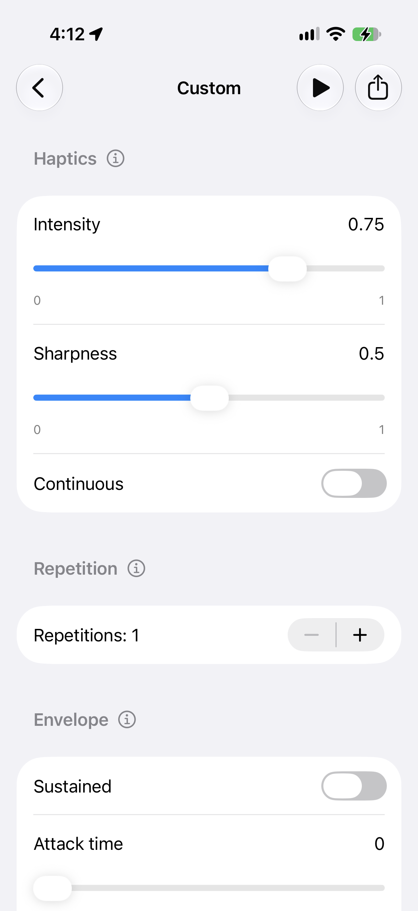

# Haptics lab

A native SwiftUI app for iOS developers and testers to compare Apple's system haptics, tune custom vibration patterns, and export those patterns as reusable Swift code.

Built with **Swift 6**, **SwiftUI**, and **Core Haptics**, with an **iOS/iPadOS 26.0** deployment target and **no third-party dependencies**. The project targets iPhone and iPad; feeling the patterns requires compatible physical hardware. A simulator cannot reproduce vibration.

## Screenshots

<table>
  <tr>
    <th>Home — System haptics</th>
    <th>Custom — Pattern controls</th>
  </tr>
  <tr>
    <td></td>
    <td></td>
  </tr>
</table>

Screenshots supplied by the maintainer, showing light appearance on hardware identifier `iPhone18,3`, iOS 27.0.1. The Home screenshot predates the addition of `Alignment*`/`Path complete*` and the revised device footer. Custom is a scrolling form; more envelope controls and **Reset to defaults** appear below the captured area. Displayed values and available controls can differ by device and event type.

## Contents

- [Features](#features)
- [Build and run](#build-and-run)
- [System haptics](#system-haptics)
- [Custom haptics](#custom-haptics)
- [Export Swift code](#export-swift-code)
- [Device capabilities and limits](#device-capabilities-and-limits)
- [Architecture and source map](#architecture-and-source-map)
- [Tests and verification](#tests-and-verification)
- [Guidance for AI agents](#guidance-for-ai-agents)
- [Contributing](#contributing)
- [Troubleshooting](#troubleshooting)
- [Scope and references](#scope-and-references)

## Features

| Feature | Current behavior |
| --- | --- |
| System feedback comparison | Thirteen predefined SwiftUI feedback choices on both iPhone and iPad, including two canvas requests marked with an Apple Pencil Pro requirement |
| Device information | Hardware identifier, OS version, detected custom-haptic support, and the canvas hardware requirement on Home |
| Transient and continuous events | Brief taps by default; turn on **Continuous** to reveal Duration |
| Intensity and sharpness | Smooth sliders within ranges reported for the selected event type |
| Exact numeric entry | Tap a slider's displayed value for a native editor with Save, Cancel, range guidance, and validation errors |
| Repetition | One to eight events; Gap appears when Repetitions is greater than one |
| Envelope shaping | Sustained, Attack time, and either Release time or Decay time, depending on the selected mode and device capabilities |
| Contextual help | Information buttons beside Haptics, Repetition, and Envelope open explanations for testers |
| Play and Stop | One toolbar button changes from Play to Stop during startup and playback |
| Swift export | Share the current configuration as a standalone `CustomHaptic.swift` file through the native share sheet, including Save to Files where available |
| Retained draft and Reset | Parameters survive navigation during the app session; **Reset to defaults** restores app timing defaults and reported transient-event parameter defaults |
| Native interface | Light/dark appearance, semantic colors, Dynamic Type, native forms and navigation, and equal-height rounded rectangle system buttons |
| Playback safeguards | Capability and value validation, cancellation, stale-callback protection, and automatic stopping when leaving Custom or when the app becomes inactive |

No accounts, analytics, third-party services, or app-owned network requests are implemented. Sharing is initiated by the user through the system share sheet. Drafts are kept in memory, not saved across app launches.

## Build and run

1. Clone or fork this repository and open [HapticsLab.xcodeproj](HapticsLab.xcodeproj) in Xcode.
2. Use an Xcode toolchain that supports the source's Swift 6 features, including `nonisolated` type declarations, and an iOS SDK with the iOS 26 SwiftUI APIs used here. The deployment target is not a claim that every older Xcode version can build the project.
3. Select the **HapticsLab** scheme and an installed iOS simulator, then choose **Product → Run** to explore the UI.
4. To feel the haptics, select a supported physical iPhone. Set your own development team under **Signing & Capabilities** and use a bundle identifier you can provision. Keep personal signing settings local.
5. Choose **Product → Test** to run the unit tests. No package installation, API keys, backend, audio assets, or AHAP files are required.

The simulator can exercise UI, validation, export generation, and pattern construction. It does not establish what any pattern feels like. See [Tests and verification](#tests-and-verification) for recorded results and remaining device checks.

## System haptics

Tap any button on Home to request its native SwiftUI feedback. These choices use Apple's default parameters; the app does not replace them with custom Core Haptics patterns.

| Button | SwiftUI API |
| --- | --- |
| Light, Medium, Heavy | `SensoryFeedback.impact(weight: .light / .medium / .heavy)` |
| Soft, Solid, Rigid | `SensoryFeedback.impact(flexibility: .soft / .solid / .rigid)` |
| Default impact | `SensoryFeedback.impact` |
| Selection | `SensoryFeedback.selection` |
| Success, Warning, Error | `SensoryFeedback.success / .warning / .error` |
| `Alignment*` | `SensoryFeedback.alignment` |
| `Path complete*` | `SensoryFeedback.pathComplete` |

All thirteen buttons appear on both iPhone and iPad without device-specific filtering. The asterisk refers to the footer: “\* Requires Apple Pencil Pro with a compatible iPad. Feedback is felt in the Pencil.” These canvas requests do not establish iPhone vibration or detect a connected Pencil; the system decides whether feedback can play. The Core Haptics custom-support check is separate from accessory feedback.

Each tap creates a request with an incrementing sequence, so repeated taps on the same button still change the `.sensoryFeedback` trigger. A recorded request is not proof that hardware delivered a vibration.

The **Custom haptics testing** row opens the screen titled **Custom**. The Home footer uses **Device model** and **OS version** labels and displays the raw hardware identifier, such as `iPhone18,3`, rather than guessing a marketing model name. It reports custom haptics as supported only when Core Haptics reports support and the app is not running in a simulator.

## Custom haptics

### Haptics

Adjust **Intensity** for strength and **Sharpness** for a softer or crisper feel. Leave **Continuous** off for a transient tap. Turn it on to expose **Duration**, which must be greater than zero and at most **30 seconds per event**. A zero duration while Continuous is on is invalid; switch Continuous off to request a tap.

The selected duration is remembered when Continuous is switched off. Changing event type keeps parameter values that fit the new reported ranges; a value outside a newly reported range resets to that parameter's default for the new event type.

### Repetition

**Repetitions** is an integer stepper from **1 to 8**, starting at **1**. Increasing it reveals **Gap**, a smooth control from **0 to 2 seconds**, initially **0.12 seconds**. All events in a pattern use the same type and parameters.

For event index `i`, repetition count `n`, effective duration `d`, and gap `g`:

```text
Transient: d = 0
Continuous: d = configured duration

Event start = i × (d + g), for i = 0 ..< n
Scheduled pattern end = (n − 1) × (d + g) + d
```

There is no trailing gap. Three continuous events of `0.4 s` with `0.15 s` gaps start at `0`, `0.55`, and `1.10 s`; the scheduled end is `1.50 s`. Envelope tails can extend the physical response into a gap, so scheduled spacing does not guarantee silence.

### Envelope

| Control | Core Haptics parameter | Behavior |
| --- | --- | --- |
| Intensity | `.hapticIntensity` | Event strength |
| Sharpness | `.hapticSharpness` | Event character |
| Sustained | `.sustained` | Selects the envelope mode; editable only when the reported range permits both off and on |
| Attack time | `.attackTime` | Shapes the rise toward the selected intensity |
| Release time | `.releaseTime` | Shown and encoded with Sustained on |
| Decay time | `.decayTime` | Shown and encoded with Sustained off |

**Envelope time values are relative/normalized parameters, not seconds.** Duration and Gap are the controls measured in seconds. Change one parameter at a time and replay to compare its effect on the installed device. Repetitions and Gap are app-defined composition controls, not Core Haptics event-parameter names.

### Exact entry, help, and defaults

Sliders have no step increment. Their value labels show up to eight significant digits; tapping an editable value opens a numeric sheet using the stored `Double`, preserving precision when opening and saving without edits. Core Haptics event parameters are ultimately encoded as `Float` values.

The editor accepts locale decimal separators and decimal digits, plus pasted decimal/scientific notation. It rejects blank or malformed input, units and grouping syntax, nonfinite/overflowing values, underflow to zero, and values outside the allowed range. Duration must also be positive. Invalid input stays in the editor with an explanation; Save does not silently clamp it. Cancel or dismissal leaves the draft unchanged. A fixed device value is displayed without an editable slider or value button.

Use the information icon beside each section name for its explanation. **Reset to defaults** restores one transient event, a stored continuous duration of `0.2 s`, and a gap of `0.12 s`, then applies the device's reported transient defaults for available parameters. Intensity, sharpness, and envelope defaults therefore should not be assumed identical across devices.

### Playback

Tap the toolbar **Play** icon to capture and play the current configuration. It becomes **Stop** while starting or playing; tap it again to cancel or stop. Edits made during playback affect the next request, not the captured pattern already playing.

Leaving Custom or moving the app out of its active state stops playback. The draft remains available when returning during the same app session. Playback errors appear in an alert. Invalid configurations prevent playback on supported hardware; on unsupported hardware, Play explains that physical haptic support is required.

## Export Swift code

1. Configure the pattern in Custom.
2. Tap **Share**, to the right of Play/Stop.
3. Share `CustomHaptic.swift` with another app, or choose **Save to Files** if offered by the system share sheet.
4. Add the file to an iOS app target and present the generated view:

```swift
ExportedHapticView()
```

The file is UTF-8 Swift source containing `ExportedHapticView` and `ExportedHapticPlayer`, using SwiftUI, Core Haptics, and Observation. It is a standalone example targeting Swift 6 and iOS 26.0+, not a dependency on the HapticsLab module. Rename the generated types if importing multiple exports into the same target.

Export uses the same validation, event timing, active parameters, and `Float` conversion as playback. It captures the **current draft**, including repetition and gap, and includes only parameters available on the exporting device. It is not a live link to subsequent edits or a recording of physical vibration.

The generated player validates support and parameter ranges on the destination device, exposes Play/Stop, handles errors and interruptions, and stops when its view disappears or its scene becomes inactive. The same configuration may feel different on another device. Export is disabled for an invalid configuration; file preparation and sharing errors are reported. Each share has a separate temporary file, retained through the share sheet and cleaned up on dismissal.

## Device capabilities and limits

At controller initialization, `CHHapticEngine.capabilitiesForHardware()` supplies support information. The app queries `attributes(forEventParameter:eventType:)` separately for transient and continuous events for all six parameters in the table above. Valid minimum, maximum, and default values become immutable capability snapshots.

- Available parameters use reported ranges, rather than a hardcoded range selected by iPhone model.
- Missing required intensity or sharpness attributes prevent validation. Missing optional envelope parameters are shown as unavailable and omitted from generated events.
- Invalid capability attributes and invalid/nonfinite user values are rejected rather than silently clamped.
- The 30-second continuous-event limit is the implementation's Core Haptics duration bound; there is no per-device duration-attribute query in this code.
- One to eight repetitions and a zero-to-two-second gap are **app limits**, not claims about the maximum composition Core Haptics supports. Together they permit up to **254 seconds of scheduled continuous events**. There is no ten-second total-pattern cap in the current implementation.

Support detection is not a vibration self-test. Perceptibility also depends on the pattern, hardware, app state, and system behavior. Zero intensity is accepted and can intentionally be silent.

## Architecture and source map

The app uses native Apple frameworks only: SwiftUI, Core Haptics, Observation, Foundation, UIKit for device information and sharing, and Darwin for the hardware identifier.

| Source | Responsibility |
| --- | --- |
| [HapticsLabApp.swift](HapticsLab/HapticsLabApp.swift) | App entry point |
| [ContentView.swift](HapticsLab/ContentView.swift) | Home, equal-height two-column grid, device footer, navigation, and scene lifecycle |
| [NativeHaptic.swift](HapticsLab/NativeHaptic.swift) | Thirteen system choices and distinct request values |
| [CustomHapticsView.swift](HapticsLab/CustomHapticsView.swift) | Haptics/Repetition/Envelope sections, help sheets, Reset, Play/Stop, and Share |
| [HapticValueEditor.swift](HapticsLab/HapticValueEditor.swift) | Locale-aware numeric parsing, exact entry, and input errors |
| [CustomHapticConfiguration.swift](HapticsLab/CustomHapticConfiguration.swift) | Sendable draft/request value, defaults, mode changes, validation, and event timing |
| [HapticCapabilities.swift](HapticsLab/HapticCapabilities.swift) | Per-event capability ranges, parameter mappings, and device identification |
| [HapticsController.swift](HapticsLab/HapticsController.swift) | Observable draft and playback state, event construction, engine lifecycle, and cancellation |
| [HapticSwiftExport.swift](HapticsLab/HapticSwiftExport.swift) | Standalone SwiftUI/Core Haptics source generation |
| [HapticShareSheet.swift](HapticsLab/HapticShareSheet.swift) | Temporary Swift attachment and native activity sheet |
| [Assets.xcassets](HapticsLab/Assets.xcassets) | Waveform app icon and native asset catalog |
| [HapticsLabTests](HapticsLabTests) | Unit tests for configuration, capabilities, lifecycle, numeric input, drafts, and export |

`ContentView` owns the `@MainActor @Observable` controller in `@State`. Custom binds to the controller's in-memory draft. Playback captures a value snapshot, while native engines, players, and observable state stay on MainActor. Asynchronous startup is cancellable; generation tokens and engine identities reject callbacks from obsolete playback. Backgrounding, navigation away, and engine interruptions stop custom playback without automatically restarting it. The engine is haptics-only and enables automatic shutdown.

To extend the app, update configuration validation, capability mappings, UI controls, export generation, and related unit coverage together. To reuse a configured pattern, start with the exported file; to reuse the editor or controller, follow the source map and preserve lifecycle and concurrency safeguards.

## Tests and verification

The current **HapticsLabTests** target contains **27 unit tests**:

| File | Coverage |
| --- | --- |
| [HapticsLabTests.swift](HapticsLabTests/HapticsLabTests.swift) | Timing, mode switches, full event duration, smooth values, device ranges, unavailable parameters, envelope encoding, snapshots, distinct native requests, and repeatable Stop |
| [HapticNumberInputTests.swift](HapticsLabTests/HapticNumberInputTests.swift) | Numeric validation, boundaries, locale input, precision, retained drafts, and Reset |
| [HapticSwiftExportTests.swift](HapticsLabTests/HapticSwiftExportTests.swift) | Exported parameters/timing, unavailable parameters, invalid drafts, attachment snapshots, independent files, cleanup, and preparation failures |

Verification is intentionally run locally by contributors and the maintainer; **GitHub Actions is not required and no CI workflow is configured**. Run affected unit tests in Xcode (or the full suite with **Product → Test** when appropriate), then finish app changes with **Product → Build**. UI tests are intentionally excluded. Test names and count describe existing coverage, not proof that a new checkout has passed. See [manual verification](CONTRIBUTING.md#manual-verification--no-github-actions-required) for the workflow and what to report.

[VERIFICATION.md](VERIFICATION.md) records dated runs, including 27 passing unit tests on the iPhone 13 mini simulator with iOS 26.5, subsequent targeted checks, and normal builds. These are historical results. Documentation-only edits need content, link, and diff checks, not a new test run.

Physical vibration, perceptual envelope behavior, hardware interruptions, execution on the minimum iOS 26.0 runtime, iPad layout, and end-to-end sharing into other apps remain unverified in the recorded checks. The supplied screenshots illustrate the interface; they do not establish these behaviors. Validate physical playback separately when shipping code derived from this sample.

## Guidance for AI agents

Read [AGENTS.md](AGENTS.md), this README, and [VERIFICATION.md](VERIFICATION.md) before implementation. Use this README as a map of the current code and the verification log as dated evidence, not as a list of checks already performed for your task.

1. Inspect repository state and preserve unrelated changes. Use **Xcode MCP** for source/resource inspection and edits, project changes, Apple documentation, builds, tests, and simulator verification. Shell/file tools may handle repository documentation and Git. Report unavailable required MCP operations instead of silently substituting shell-based Xcode commands.
2. Preserve iOS 26.0, Swift 6, native frameworks, MainActor ownership, Sendable request snapshots, strict validation, cancellation, generation checks, and engine-identity checks. Keep the UI native with semantic colors and native padding.
3. Review SwiftUI edits using available guidance, identifying whether it is a locally exposed skill or an external exported copy. Do not claim an unavailable skill was invoked.
4. Run affected unit tests and finish app changes with a normal build through Xcode MCP. Do not reintroduce UI tests or add GitHub Actions/required CI checks unless the maintainer explicitly requests a workflow change. Report the actual simulator/runtime, skipped checks, and hardware limitations. Source edits, simulator tests, and physical vibration checks are different evidence.
5. Keep personal signing values, credentials, Xcode user state, and build output out of commits. Inspect the full staged diff, including signing configuration, before committing. Never install on physical hardware or change repository visibility without an explicit request.
6. Keep feature documentation aligned with the code when behavior changes. Do not add capabilities merely because an Apple API exists; availability alone does not establish an iPhone vibration effect.

**Historical research:** The dated [capability study](Docs/HAPTICS_STUDY.md) predates later UI, export, and test changes and is awaiting a separate maintenance pass. Use the current source and this README for implemented behavior.

## Contributing

Read [CONTRIBUTING.md](CONTRIBUTING.md) for project constraints. Fork the repository, make a focused change on a branch, and open a pull request describing the problem, resulting behavior, and verification performed. For haptic reports, include the hardware identifier, iOS version, selected values, and whether testing used a physical device or simulator.

Human contributors use Xcode directly; Xcode MCP is required only for coding agents. The maintainer reviews and locally verifies contributions before merging into `main`. Owner-only merging is a separate access policy and does not depend on GitHub Actions; GitHub enforcement must be configured separately.

Keep contributions native and dependency-free. Separate reproducible software behavior from subjective tactile observations, and do not include personal signing settings. Contributions use the repository's [MIT license](LICENSE).

## Troubleshooting

| Symptom | What to check |
| --- | --- |
| No vibration in the simulator | Expected; use supported physical hardware to feel patterns |
| `Alignment*` or `Path complete*` produces no iPhone vibration | These canvas requests are provided for Apple Pencil Pro on compatible iPads; see the asterisk explanation on Home |
| Home says custom haptics are unavailable | The device is a simulator or the Core Haptics support check returned false |
| Play is unavailable on supported hardware | Check parameter ranges and ensure Continuous duration is greater than zero |
| Numeric Save does not dismiss the editor | Read the inline error; use a finite value in range without units or grouping syntax |
| An envelope control is unavailable or fixed | The reported capability for that event type is absent or does not allow editing |
| A custom pattern is silent | Check intensity, hardware support, foreground state, and system settings |
| Playback stops after leaving Custom or backgrounding | Expected lifecycle cleanup; return and press Play again |
| Share is unavailable or fails | Validate the current draft; check the sharing error and destination app's support for `.swift` files |
| Exported code reports unsupported values | The destination device's capabilities differ; retune the pattern on that device |
| Physical-device build fails to sign | Configure your own team and provisionable bundle identifier locally |

## Scope and references

Haptics lab provides **built-in iPhone vibration testing** and native Alignment/Path complete requests for **Apple Pencil Pro on compatible iPads**. The canvas buttons are visible on both device families and include a hardware-requirement footnote; physical Pencil feedback remains unverified. Audio, custom accessory/controller haptic patterns, mixed-event timeline editing, dynamic parameter curves, pause/resume/seek, indefinite looping, playback-rate controls, AHAP import/export, and saved preset libraries are not implemented. Swift source export and finite repetition are implemented as described above.

Relevant Apple documentation:

- [SwiftUI SensoryFeedback](https://developer.apple.com/documentation/swiftui/sensoryfeedback)
- [Apple Pencil canvas feedback](https://developer.apple.com/documentation/ApplePencil/playing-haptic-feedback-in-your-app#Play-feedback-for-canvas-events)
- [Core Haptics](https://developer.apple.com/documentation/corehaptics)
- [Device capabilities](https://developer.apple.com/documentation/corehaptics/chhapticdevicecapability)
- [Haptic event parameters](https://developer.apple.com/documentation/corehaptics/chhapticevent/parameterid)
- [Continuous haptic events](https://developer.apple.com/documentation/corehaptics/chhapticevent/eventtype/hapticcontinuous)
- [AHAP parameter and envelope semantics](https://developer.apple.com/documentation/corehaptics/representing-haptic-patterns-in-ahap-files)

## License

[MIT](LICENSE). Copyright © 2026 Sahil Satralkar.
