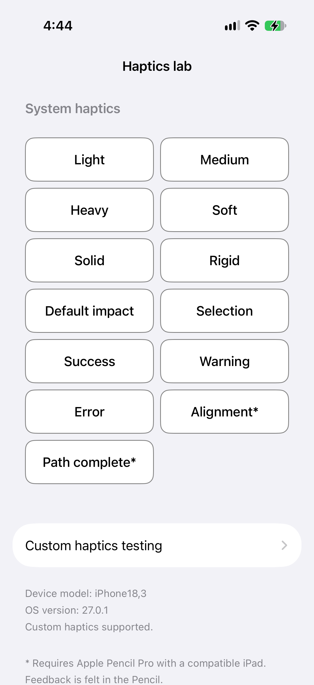
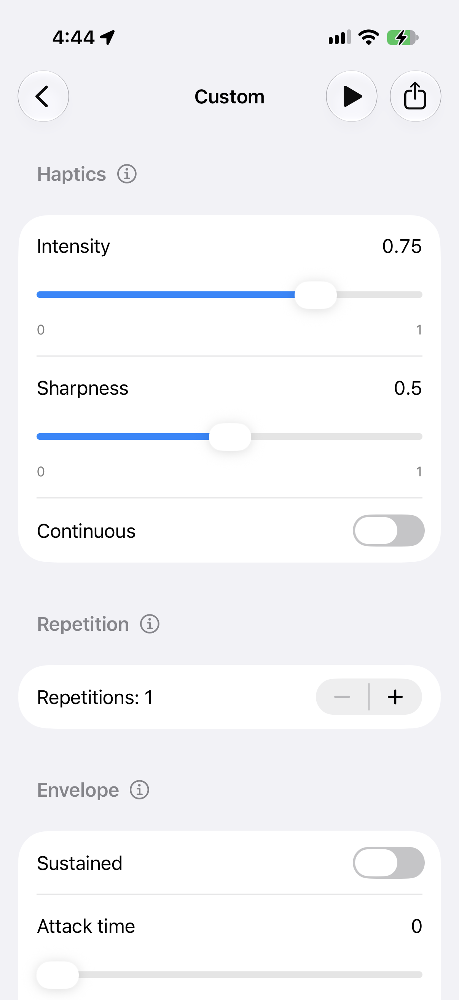

# Haptics lab

Explore Apple's system haptics, build your own vibration patterns, and take the Swift code into your app. Haptics lab is a small SwiftUI app for iOS developers and testers who want to try a pattern and understand how it works.

It runs on **iPhone and iPad with iOS/iPadOS 26.0 or later**, uses **Swift 6**, **SwiftUI**, and **Core Haptics**, and has **no third-party dependencies**. You can explore the interface in a simulator, but you'll need compatible physical hardware to feel the feedback.

The current source version is [**v1.3 (build 4)**](https://github.com/sahilsatralkar/HapticsLab/tree/v1.3), with a clearer choice between constant intensity/sharpness and values that vary over time. Choose the `v1.3` tag for this version, or build `main` for ongoing development. The latest published GitHub release is [v1.2](https://github.com/sahilsatralkar/HapticsLab/releases/tag/v1.2). See the [changelog](CHANGELOG.md) for changes by version.

## Screenshots

<table>
  <tr>
    <th>Home — System haptics</th>
    <th>Custom — Pattern controls</th>
  </tr>
  <tr>
    <td></td>
    <td></td>
  </tr>
</table>

These screenshots were supplied by the maintainer and show light appearance. The Custom capture predates the configurable curve controls described below. Home shows all thirteen System haptics buttons with the updated typography, the Custom navigation row, device information, and the Apple Pencil Pro footnote. On Custom, scroll down for the remaining envelope controls and **Reset to defaults**. Values and available controls can vary by device and event type.

## Contents

- [Changelog and versions](CHANGELOG.md)
- [Features](#features)
- [Build and run](#build-and-run)
- [System haptics](#system-haptics)
- [Custom haptics](#custom-haptics)
- [Export Swift code](#export-swift-code)
- [Device capabilities and limits](#device-capabilities-and-limits)
- [Architecture and source map](#architecture-and-source-map)
- [Tests and verification](#tests-and-verification)
- [Guidance for AI agents](#guidance-for-ai-agents)
- [Contributing](#contributing)
- [Troubleshooting](#troubleshooting)
- [Scope and references](#scope-and-references)

## Features

| What you can do | How it works |
| --- | --- |
| Compare system haptics | Try thirteen native feedback choices, including two canvas effects marked with an Apple Pencil Pro requirement |
| Check your device | See its hardware identifier, OS version, and whether custom haptics are supported |
| Try taps or longer vibrations | Leave **Continuous** off for brief taps, or turn it on to set a Duration |
| Adjust the feel | Use **Constant** for one Intensity and Sharpness pair, with smooth sliders within the device's reported ranges |
| Change the feel over time | With Continuous on, choose **Vary over time** and edit 2–16 timed intensity/sharpness points; switching modes retains both sets of values |
| Enter an exact value | Tap a slider's number to type a value, with range guidance and validation |
| Repeat a pattern | Choose one to eight repetitions and set the Gap between them |
| Shape the envelope | Explore Sustained, Attack time, and Release time or Decay time where supported |
| Learn as you test | Tap the information button beside Haptics, Repetition, or Envelope for help |
| Play and stop | Use one toolbar button to start playback or stop it, including during startup |
| Reuse your work | Share the current pattern as a standalone `CustomHaptic.swift` file |
| Keep experimenting | Return to Custom without losing your draft during the app session, or use **Reset to defaults** |
| Use familiar controls | Native forms, navigation, light/dark appearance, Dynamic Type, and equal-height rounded rectangle buttons |
| Leave playback safely | Playback stops when you leave Custom or the app becomes inactive; validation and cancellation protect playback requests |

There's no account to create, and the app has no analytics or app-owned network requests. Sharing happens only when you choose it. Your draft stays in memory during the app session; it isn't saved between launches.

## Build and run

You'll need a Mac with Xcode that supports Swift 6 and the iOS 26 SDK or newer. There are no packages, API keys, or backend services to set up.

1. Clone this repository, or choose **Code → Download ZIP** on GitHub and unzip it.
2. Open [HapticsLab.xcodeproj](HapticsLab.xcodeproj) in Xcode.
3. In Xcode's toolbar, select the **HapticsLab** scheme and an iPhone or iPad simulator running iOS/iPadOS 26 or later.
4. Click **Run** (▶), or press **⌘R**.

You can now explore the screens, edit values, and export Swift code. The simulator won't produce vibrations.

### Try it on your device

1. Connect your iPhone or iPad to your Mac and select it as the run destination in Xcode.
2. Select the **HapticsLab** app target, open **Signing & Capabilities**, and choose your development team. If Xcode asks for a unique bundle identifier, replace it with one you can use.
3. Follow any trust or Developer Mode prompts, then click **Run**.

Use a supported iPhone to feel custom vibration patterns. For **Alignment\*** and **Path complete\***, you'll need Apple Pencil Pro with a compatible iPad; the feedback is felt in the Pencil. Keep your signing settings local when contributing.

To run the unit tests, choose **Product → Test** or press **⌘U**. See [Tests and verification](#tests-and-verification) for what the tests cover.

## System haptics

Tap a button on Home to try Apple's native feedback with its default parameters. This gives you a baseline to compare with your custom patterns. Button labels use the native body text style with medium weight, scale with Dynamic Type, and wrap when needed.

| Button | SwiftUI API |
| --- | --- |
| Light, Medium, Heavy | `SensoryFeedback.impact(weight: .light / .medium / .heavy)` |
| Soft, Solid, Rigid | `SensoryFeedback.impact(flexibility: .soft / .solid / .rigid)` |
| Default impact | `SensoryFeedback.impact` |
| Selection | `SensoryFeedback.selection` |
| Success, Warning, Error | `SensoryFeedback.success / .warning / .error` |
| `Alignment*` | `SensoryFeedback.alignment` |
| `Path complete*` | `SensoryFeedback.pathComplete` |

You'll see all thirteen buttons on both iPhone and iPad. The asterisk points to the footer: “\* Requires Apple Pencil Pro with a compatible iPad. Feedback is felt in the Pencil.” These two buttons don't detect whether a Pencil is connected. The system decides whether it can play the feedback, and you shouldn't expect these effects to vibrate an iPhone.

Each tap creates a new request, even when you tap the same button repeatedly. In code, an incrementing sequence keeps the `.sensoryFeedback` trigger changing. Sending a request doesn't confirm that the hardware produced feedback.

Choose **Custom haptics testing** to open **Custom**. The Home footer also shows **Device model**, **OS version**, and custom-haptic support. The model is a hardware identifier such as `iPhone18,3`. “Custom haptics supported” appears only when Core Haptics reports support and the app isn't running in a simulator; it doesn't indicate Pencil support.

## Custom haptics

### Haptics

Start with **Intensity** to adjust strength and **Sharpness** to move from a softer feel to a crisper one. Leave **Continuous** off for brief taps. Turn it on to reveal **Duration** and choose how long each vibration lasts, up to **30 seconds**. A native **Intensity and sharpness** segmented control then offers two ways to set the feel:

- **Constant:** one Intensity and Sharpness pair applies throughout the vibration.
- **Vary over time:** timed points change those same properties during the vibration.

Only the selected mode's controls appear and affect playback or export. Switching between these modes keeps your constant values and curve points separately, so you can compare them without re-entering values. With Continuous off, only the constant controls apply.

Continuous events need a duration greater than zero. To return to taps, turn Continuous off; your chosen duration is remembered for next time. Switching between transient and continuous events keeps values that fit the new event type's ranges. Values outside those ranges return to the device's reported defaults for that event type.

### Vary over time

With Continuous on, select **Vary over time** to replace the constant Intensity and Sharpness sliders with a list of curve points. The device must report both dynamic-parameter ranges. The first selection creates three points using your existing constant values, so the initial shape is flat. Later selections restore the curve you last edited rather than recreating it from the constant values.

- Expand **Start**, **End**, or an intermediate **Point** to edit its Intensity and Sharpness with smooth sliders or exact numeric entry.
- Start stays at 0 seconds and End follows Duration. Intermediate times must remain strictly between their neighbours. Invalid typed times are rejected without changing the draft.
- **Add point** inserts a point halfway through the largest available time interval, with interpolated values that preserve the existing shape. **Delete point** removes an intermediate point and connects its neighbours directly.
- Use **2–16 points**. This is an app limit, not a device-reported maximum. Start and End cannot be deleted.
- Changing Duration scales all point times proportionally. Choosing Constant or turning Continuous off retains the curve for later; Reset to defaults clears it.

Core Haptics interpolates linearly between points. Point values describe the requested event intensity and sharpness before the Envelope's effect. Internally, intensity curves multiply a base event intensity and sharpness curves add an offset. The app validates both event ranges and device-reported dynamic ranges, including the combined Float values; unsupported combinations block Play and Share and show an inline error.

Each repetition restarts the complete curve. The existing Envelope still affects the result; for initial curve experiments, try Sustained on and minimum Attack/Release values. Sharpness changes tactile character, not engine RPM or a directly selectable vibration frequency. Test the feel on supported physical hardware.

For a starting rise-and-fall experiment, set Duration to **1.2 s**, keep one repetition, and edit the three points as follows:

| Point | Time | Intensity | Sharpness |
| --- | --- | --- | --- |
| Start | 0 s | 0.15 | 0.15 |
| Point 2 | 0.4 s | 0.95 | 0.65 |
| End | 1.2 s | 0 | 0.20 |

Use Sustained on and minimum Attack/Release values initially, then adjust one setting at a time. These are experimental values, not a calibrated engine simulation; record what you feel on your device.

### Repetition

Use **Repetitions** to play the same event **1 to 8 times**. When you choose more than one, **Gap** appears so you can set the spacing from **0 to 2 seconds**. The starting values are one repetition and a stored gap of **0.12 seconds**.

Every repetition uses the same event type and parameters. There is no gap after the last event. For example, three vibrations lasting `0.4 s` with `0.15 s` gaps start at `0`, `0.55`, and `1.10 s`, with a scheduled end of `1.50 s`. An envelope can extend the physical response into a gap, so the gap doesn't always mean silence.

If you're inspecting or reusing the timing code, `i` is the event index, `n` is the repetition count, `d` is the event duration, and `g` is the gap:

```text
Transient: d = 0
Continuous: d = configured duration

Event start = i × (d + g), for i = 0 ..< n
Scheduled pattern end = (n − 1) × (d + g) + d
```

### Envelope

These controls let you explore how a vibration starts and fades. Try changing one value at a time and replaying the pattern to feel the difference.

| Control | Core Haptics parameter | What it does |
| --- | --- | --- |
| Intensity | `.hapticIntensity` | Sets the event's strength |
| Sharpness | `.hapticSharpness` | Changes the event's feel |
| Sustained | `.sustained` | Selects the envelope mode; you can toggle it only when the device's range supports both values |
| Attack time | `.attackTime` | Shapes the rise toward the selected intensity |
| Release time | `.releaseTime` | Appears and is included in the pattern when Sustained is on |
| Decay time | `.decayTime` | Appears and is included in the pattern when Sustained is off |

**Attack time, Decay time, and Release time use relative/normalized values, not seconds.** Duration and Gap are measured in seconds. Repetitions and Gap are labels for this app's pattern controls, rather than Core Haptics event-parameter names.

### Exact entry, help, and defaults

The sliders move smoothly without fixed steps. For a precise value, tap the number beside a slider, type your value, and choose **Save**. **Cancel** or dismissing the sheet leaves your draft unchanged. If a device reports a fixed value, you'll see it without an editable control.

You can use your locale's decimal separator and digits, or paste decimal and scientific notation. The editor explains invalid entries instead of silently changing them to fit the range. It rejects empty or malformed input, units, digit grouping, values outside the range, nonfinite numbers, overflow, and nonzero values so small they round to zero. Duration must also be positive.

For developers: labels show up to eight significant digits, but the editor opens with the stored `Double`. Opening and saving without edits preserves that value. Core Haptics event parameters are converted to `Float` when the pattern is built.

Tap a section's information icon for help with its controls. To start again, choose **Reset to defaults**. This restores one tap, a stored continuous duration of `0.2 s`, a gap of `0.12 s`, and the device's reported transient defaults for available parameters. Intensity, sharpness, and envelope defaults can therefore differ between devices.

### Playback

Tap **Play** in the toolbar to try your current pattern. The same button becomes **Stop** during startup and playback. Any edits you make while it's playing apply to the next request.

Playback stops when you leave Custom or the app becomes inactive. Your draft is still there when you return during the same app session. Errors appear in an alert. An invalid configuration prevents playback on supported hardware; on unsupported hardware, Play explains that physical haptic support is needed.

## Export Swift code

When you've found a pattern you want to reuse:

1. Tap **Share**, to the right of Play/Stop in Custom.
2. Send `CustomHaptic.swift` to another app, or choose **Save to Files** if it's available in the share sheet.
3. Add the file to your iOS app target and present the generated view:

```swift
ExportedHapticView()
```

The file contains `ExportedHapticView` and `ExportedHapticPlayer`, using SwiftUI, Core Haptics, and Observation. It's standalone UTF-8 Swift source for Swift 6 and iOS 26.0 or later, so you don't need to add HapticsLab to your app. If you import several exports, rename the generated types to avoid name conflicts.

Each export captures your **current draft**, including repetition, gap, the parameters available on the exporting device, and any active intensity/sharpness curves. It uses the same validation, timing, and `Float` conversion as playback. Later edits won't change an already shared file.

The header also records the exporting device type and hardware identifier, its iOS/iPadOS version, and whether it is a simulator or physical device. For example:

```swift
// Exported from device: iPhone (iPhone18,3)
// iOS/iPadOS version: 27.0.1
// Environment: Physical device
```

These comments capture where the file was exported, so testers can compare results across devices. They don't describe the device that later runs the file or determine haptic support.

The generated player checks the destination device's support, event and dynamic parameter ranges, and combined curve values, provides Play/Stop, handles errors and interruptions, and stops when its view disappears or the app becomes inactive. Try the result on your destination device: the same values may feel different on different hardware.

Share is disabled while the configuration is invalid. If file preparation or sharing fails, the app shows an error. Each share uses its own temporary file, which stays available through sharing and is cleaned up when the sheet is dismissed.

## Device capabilities and limits

The app asks Core Haptics what the device supports instead of choosing ranges from its model name. It uses `CHHapticEngine.capabilitiesForHardware()` and queries `attributes(forEventParameter:eventType:)` for all six parameters, separately for transient and continuous events. Valid minimum, maximum, and default values are stored as immutable capability snapshots.

A few details are useful when testing:

- If the device doesn't report required Intensity or Sharpness attributes, the pattern can't pass validation.
- Optional envelope parameters that aren't available are shown as unavailable and left out of generated events.
- Invalid capability data and invalid or nonfinite input are rejected. Values aren't silently clamped.
- Continuous events are limited to **30 seconds each**. The app doesn't query a device-specific duration limit.
- **2–16 curve points**, **1–8 repetitions**, and a **0–2-second gap** are app limits. Together, they allow up to **254 seconds of scheduled continuous events**. There is no ten-second total-pattern cap.

A support check can't tell you what a pattern will feel like. The result also depends on the hardware, app state, and system behavior. An intensity of zero is valid and can be intentionally silent.

## Architecture and source map

If you'd like to change the app or reuse part of it, start here. It uses native Apple frameworks only: SwiftUI, Core Haptics, Observation, Foundation, UIKit for device information and sharing, and Darwin for the hardware identifier.

| Source | What you'll find |
| --- | --- |
| [HapticsLabApp.swift](HapticsLab/HapticsLabApp.swift) | App entry point |
| [ContentView.swift](HapticsLab/ContentView.swift) | Home, equal-height two-column grid, device footer, navigation, and scene lifecycle |
| [NativeHaptic.swift](HapticsLab/NativeHaptic.swift) | Thirteen system choices and distinct request values |
| [CustomHapticsView.swift](HapticsLab/CustomHapticsView.swift) | Haptics/Repetition/Envelope sections, help sheets, Reset, Play/Stop, and Share |
| [HapticValueEditor.swift](HapticsLab/HapticValueEditor.swift) | Locale-aware numeric parsing, exact entry, and input errors |
| [CustomHapticConfiguration.swift](HapticsLab/CustomHapticConfiguration.swift) | Sendable draft/request value, defaults, mode changes, validation, and event timing |
| [HapticCapabilities.swift](HapticsLab/HapticCapabilities.swift) | Per-event capability ranges, parameter mappings, and device identification |
| [HapticsController.swift](HapticsLab/HapticsController.swift) | Observable draft and playback state, event construction, engine lifecycle, and cancellation |
| [HapticSwiftExport.swift](HapticsLab/HapticSwiftExport.swift) | Standalone SwiftUI/Core Haptics source generation |
| [HapticShareSheet.swift](HapticsLab/HapticShareSheet.swift) | Temporary Swift attachment and native activity sheet |
| [Assets.xcassets](HapticsLab/Assets.xcassets) | Waveform app icon and native asset catalog |
| [HapticsLabTests](HapticsLabTests) | Unit tests for configuration, capabilities, lifecycle, numeric input, drafts, and export |

`ContentView` owns the `@MainActor @Observable` controller in `@State`, and Custom binds to the controller's in-memory draft. Playback takes an immutable snapshot of that draft. Native engines, players, and observable state stay on MainActor.

Startup can be cancelled. Generation tokens and engine identities prevent old asynchronous callbacks from affecting newer playback. Leaving Custom, making the app inactive, or interrupting the engine stops playback without an automatic restart. The engine plays haptics only and uses automatic shutdown.

When adding a parameter, keep validation, capability mappings, controls, export, and related tests in sync. Curve values use separate dynamic-parameter ranges and keep stable point identities across edits. If you just want to reuse a pattern, the exported Swift file is the quickest starting point.

## Tests and verification

The **HapticsLabTests** target has **40 unit tests**:

| File | What it covers |
| --- | --- |
| [HapticsLabTests.swift](HapticsLabTests/HapticsLabTests.swift) | Timing, mode switches, full event duration, smooth values, device ranges, unavailable parameters, envelope encoding, snapshots, distinct native requests, and repeatable Stop |
| [HapticCurveTests.swift](HapticsLabTests/HapticCurveTests.swift) | Point insertion/deletion, timing validation, capability failures, curve encoding, repetition, silent patterns, retained drafts, and export parity |
| [HapticNumberInputTests.swift](HapticsLabTests/HapticNumberInputTests.swift) | Numeric validation, boundaries, locale input, precision, retained drafts, and Reset |
| [HapticSwiftExportTests.swift](HapticsLabTests/HapticSwiftExportTests.swift) | Exported parameters/timing, device metadata and runtime detection, unavailable parameters, invalid drafts, attachment snapshots, independent files, cleanup, and preparation failures |

Run affected unit tests in Xcode, or choose **Product → Test** for the full suite. Finish app changes with **Product → Build**. We run verification locally: **GitHub Actions isn't required, and no CI workflow is configured.** UI tests are intentionally excluded. The [contribution guide](CONTRIBUTING.md#manual-verification--no-github-actions-required) explains the manual checks and what to include in a PR.

For documentation-only changes, check the content, links, images, and diff; there's no need to build or run app tests.

[VERIFICATION.md](VERIFICATION.md) records what was tested and when, including the 43-test segmented-control pass on the iPhone 13 mini simulator with iOS 26.5. Earlier curve-feature checks also compiled generated source alongside the app. Version-only changes receive a new build check; they do not imply the test suite ran again. Those results describe those runs, so please run the relevant checks for your own changes.

Physical vibration, envelope feel, hardware interruptions, the minimum iOS 26.0 runtime, iPad layout, and sharing into other apps still need verification in the recorded checks. Screenshots show the interface, but don't verify those behaviors. Test physical playback before shipping code based on this sample.

## Guidance for AI agents

Start with [AGENTS.md](AGENTS.md), this README, and [VERIFICATION.md](VERIFICATION.md). The README describes the current app; the verification log records past checks.

- Follow the tool workflow in AGENTS.md. It currently requires **Xcode MCP** for app source/resource work, project changes, Apple documentation, builds, tests, and simulator verification. Use shell/file tools for repository documentation and Git. Report an unavailable required operation instead of silently substituting shell-based Xcode commands.
- Preserve Swift 6, the iOS/iPadOS 26.0 deployment target, native frameworks, MainActor ownership, Sendable snapshots, validation, cancellation, and stale-callback checks.
- Review SwiftUI changes with available guidance and say whether it came from a locally exposed skill or an external copy. Don't claim to have used a skill that wasn't available.
- Run affected unit tests, then a normal build through Xcode MCP. Report the actual destination/runtime, results, and skipped checks. Don't add UI tests, GitHub Actions, or required CI checks unless the maintainer requests that change.
- Preserve unrelated work and local signing settings. Inspect the complete staged diff before committing. Physical-device installation and repository visibility changes need an explicit request.
- Keep documentation aligned with the code. An available API or a successful simulator test doesn't establish physical feedback.

The [capability study](Docs/HAPTICS_STUDY.md), with implementation updates through 20 October 2026, maps the current controls and Swift export to Apple APIs and distinguishes implemented features from other framework capabilities. Confirm later changes against the source.

## Contributing

Bug reports, feature ideas, and focused pull requests are welcome. Start with [CONTRIBUTING.md](CONTRIBUTING.md), then use the [issue template](.github/ISSUE_TEMPLATE/community_issue.md) or [PR template](.github/pull_request_template.md) to share the details.

For a haptic report, tell us which device and OS you used, which values you tried, whether it was a simulator or physical device, and what you observed. For code changes, fork the repository, work on a branch, and open a PR against `main` with your verification results.

You can contribute using Xcode directly; no AI assistant or MCP setup is needed to submit a PR. Agents should follow the separate instructions above. The maintainer reviews and locally verifies changes before merging.

GitHub's active [Owner-only main updates ruleset](https://github.com/sahilsatralkar/HapticsLab/rules/24876927) allows only **sahilsatralkar** to push or merge into `main`. Everyone else contributes through a PR for the owner to review and merge. Deleting or recreating `main` is also restricted to the owner. This protection doesn't require GitHub Actions or CI checks.

Keep changes native and dependency-free, and leave personal signing settings out of commits. Contributions use the [MIT license](LICENSE).

Found a security issue? Please use [private vulnerability reporting](https://github.com/sahilsatralkar/HapticsLab/security/advisories/new), rather than a public issue. Our [security policy](SECURITY.md) explains what to include. Repository secret scanning and push protection are enabled; please still review your diff for credentials and personal signing details.

## Troubleshooting

| What you're seeing | What to try |
| --- | --- |
| No vibration in the simulator | Use supported physical hardware to feel the pattern |
| `Alignment*` or `Path complete*` doesn't vibrate your iPhone | Try Apple Pencil Pro on a compatible iPad; these canvas effects are felt in the Pencil |
| Home says custom haptics are unavailable | Check whether you're using a simulator or a device without Core Haptics support |
| Play is unavailable on supported hardware | Check the parameter ranges and use a positive Duration when Continuous is on |
| Save won't close the numeric editor | Read the inline error and enter a finite number in range, without units or digit grouping |
| Vary over time is unavailable | Turn on Continuous to show the segmented control; both dynamic Intensity and Sharpness ranges must be reported by the device |
| A point time is rejected | Keep it strictly between the adjacent points; Start and End times are fixed |
| Curves are silent or unexpected | Check every point's intensity, the Envelope settings, and the inline validation message; confirm the feel on physical hardware |
| An envelope control is unavailable or fixed | The device hasn't reported an editable range for that parameter and event type |
| A custom pattern is silent | Check intensity, hardware support, foreground state, and system settings |
| Playback stops when you leave Custom or background the app | This is expected; return to Custom and press Play again |
| Share is unavailable or fails | Check your values, the error message, and whether the destination app accepts `.swift` files |
| Exported code reports unsupported values | Adjust the pattern for the destination device's capabilities |
| Xcode can't sign a device build | Choose your development team and a bundle identifier you can provision |

## Scope and references

The app covers built-in iPhone vibration testing and native Alignment/Path complete requests for Apple Pencil Pro on compatible iPads. Both canvas buttons appear on iPhone and iPad with a hardware footnote; physical Pencil feedback still needs verification.

It doesn't currently include audio, custom accessory/controller patterns, mixed-event timelines, live parameter updates while playing, pause/resume/seek, indefinite looping, playback-rate controls, AHAP import/export, or saved preset libraries. You can use finite repetition and Swift source export as described above.

For the underlying APIs, see Apple's documentation:

- [SwiftUI SensoryFeedback](https://developer.apple.com/documentation/swiftui/sensoryfeedback)
- [Apple Pencil canvas feedback](https://developer.apple.com/documentation/ApplePencil/playing-haptic-feedback-in-your-app#Play-feedback-for-canvas-events)
- [Core Haptics](https://developer.apple.com/documentation/corehaptics)
- [Device capabilities](https://developer.apple.com/documentation/corehaptics/chhapticdevicecapability)
- [Haptic event parameters](https://developer.apple.com/documentation/corehaptics/chhapticevent/parameterid)
- [Continuous haptic events](https://developer.apple.com/documentation/corehaptics/chhapticevent/eventtype/hapticcontinuous)
- [AHAP parameter and envelope semantics](https://developer.apple.com/documentation/corehaptics/representing-haptic-patterns-in-ahap-files)

## License

[MIT](LICENSE). Copyright © 2026 Sahil Satralkar.
